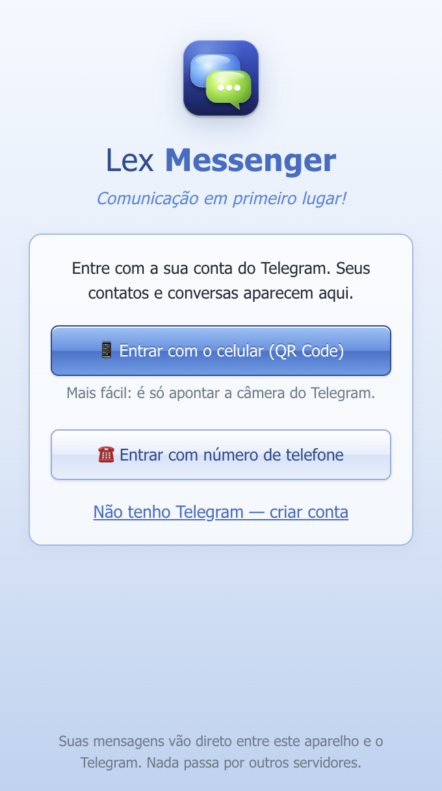
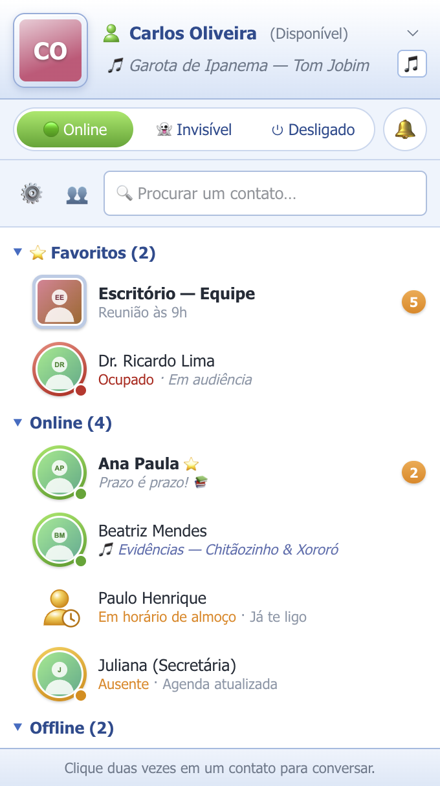
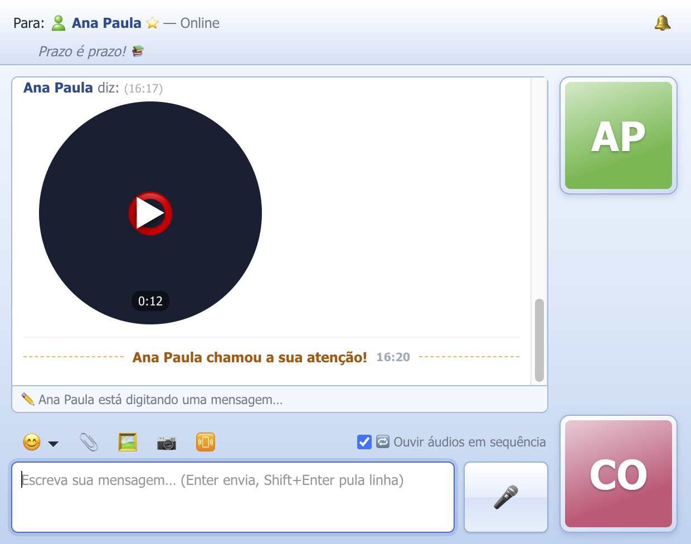
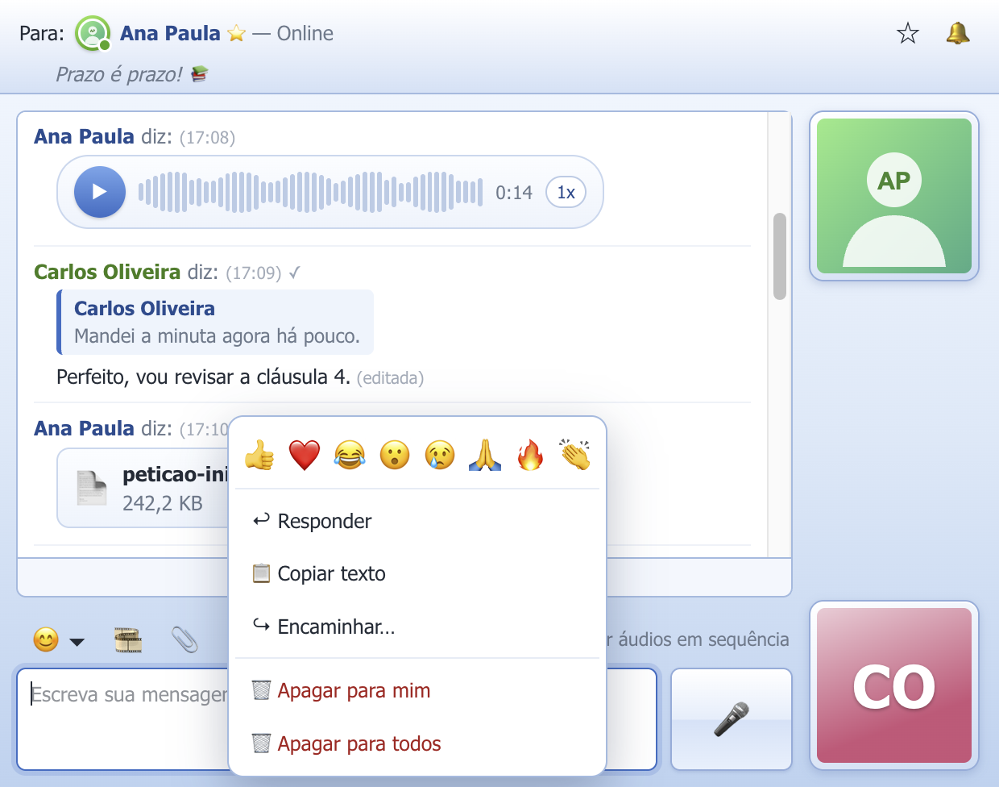
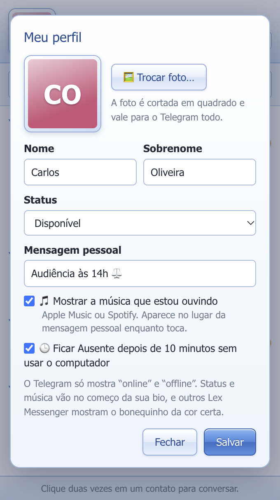
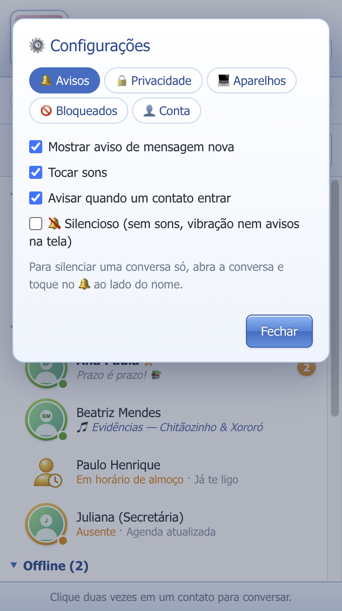
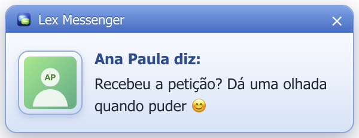
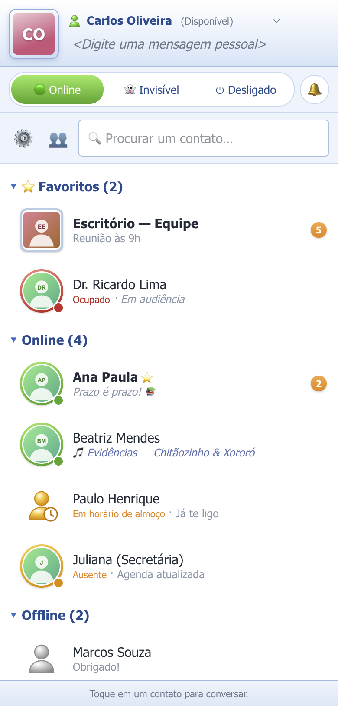
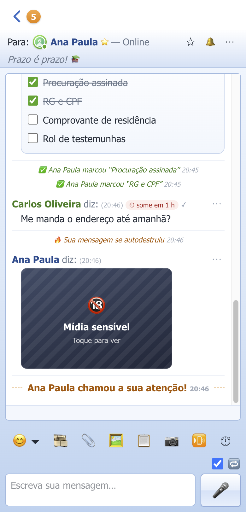

<h1 align="center">Lex Messenger</h1>

<b><i>Comunicação em primeiro lugar!</i></b>

Um mensageiro para conversar — e só. 
Com o jeitinho dos mensageiros dos anos 2000 e a sua conta do Telegram. Gratuito e de código aberto.

  <a href="https://github.com/oliveiracarlosadv/Lex-Messenger/releases/latest/download/LexMessenger-macOS-arm64.dmg"><b>⬇️ Mac (Apple M1, M2, M3, M4)</b></a> ·
  <a href="https://github.com/oliveiracarlosadv/Lex-Messenger/releases/latest/download/LexMessenger-macOS-x64.dmg"><b>⬇️ Mac (Intel)</b></a> ·
  <a href="https://github.com/oliveiracarlosadv/Lex-Messenger/releases/latest/download/LexMessenger-Windows-Instalador.exe"><b>⬇️ Windows</b></a> ·
  <a href="https://github.com/oliveiracarlosadv/Lex-Messenger/releases/latest/download/LexMessenger-Android.apk"><b>⬇️ Android</b></a> ·
  <a href="https://oliveiracarlosadv.github.io/Lex-Messenger/"><b>📱 iPhone (pelo Safari)</b></a>

<a href="https://github.com/oliveiracarlosadv/Lex-Messenger/releases">Todas as versões</a> · <a href="docs/LANCAMENTO.md">Conheça o Lex</a> · <a href="docs/MANUAL.md">Manual</a> (<a href="docs/Manual-Lex-Messenger.pdf">PDF</a>) · <a href="docs/PRIVACIDADE.md">Privacidade</a> · <a href="docs/TERMOS.md">Termos</a>

---

  
  

  
  
  

  
  

As imagens usam contatos fictícios.

## Por que o Lex Messenger existe

Lembra quando abrir o mensageiro era só para **conversar**? A lista de amigos, a janelinha subindo no canto da tela com
“Fulano diz:”, o barulhinho de mensagem nova, a janela tremendo quando alguém chamava a sua atenção.

Com o tempo, os mensageiros viraram outra coisa: stories, canais, feeds, anúncios, sugestões, figurinhas pagas,
notificações de tudo que não é conversa. A mensagem de quem importa ficou perdida no meio do barulho.

O **Lex Messenger** volta ao essencial. É **conversa pura**:

- **Sem stories.** Ninguém precisa assistir à vida de ninguém para conversar.
- **Sem feed de canais.** A lista é das pessoas e dos grupos com quem você fala.
- **Sem propaganda.** Nenhum anúncio, nenhum patrocinado, nenhum rastreador.
- **Sem servidor no meio.** O app fala direto com o Telegram. Nada passa por nós, nada é coletado.
- **Sem custo.** É gratuito e o código está todo aqui, aberto, para quem quiser conferir.

Ele usa a **API oficial do Telegram**, então você entra com a sua conta de sempre e conversa com qualquer pessoa que
tenha Telegram, use ela o Lex ou não. Tudo o que é conversa está aqui: texto, áudio, foto, vídeo, recado, arquivos,
grupos, mensagens que se autodestroem. O resto ficou de fora de propósito.

**Comunicação em primeiro lugar!**

### Quem fez

O Lex Messenger foi idealizado e criado por **Carlos Alexandre Albuquerque Oliveira**, advogado, pela
**Lex Tecnologias**. Nasceu de uma vontade simples: ter um lugar para conversar com as pessoas sem que o aplicativo
dispute a sua atenção com elas.

## O que ele faz

- **Entra com a sua conta do Telegram**, pelo QR Code (aponte a câmera do celular) ou pelo número de telefone — e quem **não tem Telegram** pode **criar a conta** ali mesmo.
- **Lista de contatos** separada em Favoritos, Online, Offline e Grupos, com quem está ausente e mensagens não lidas.
- **Uma janela para cada conversa**: cada mensagem com o nome de quem enviou e a hora em cima, fotos de perfil e o aviso “está digitando…”.
- **Mensagens que se autodestroem** ⏱: escolha 30 s, 1 min, 5 min, 1 h ou 24 h; a mensagem some para os dois lados e o aviso 🔥 também some em 12 horas.
- **Mídia sensível** 🔞: fotos, vídeos e recados chegam cobertos e só aparecem quando a pessoa toca; ao fechar, voltam a ficar cobertos.
- **Lista de tarefas** 📋 na conversa: você cria, a outra pessoa marca como feito, e os dois veem o progresso.
- **Figurinhas e GIFs** 🎞️ (recentes, seus pacotes, GIFs salvos e busca), tocando dentro da conversa — assim como **vídeos e áudios**.
- **Nova conversa** ✏️ com os seus contatos do Telegram e, no Android, a **agenda do celular** (mostra quem tem Telegram e convida quem não tem).
- **Favoritos** ⭐ no topo da lista (pasta “Favoritos” do Telegram, igual em todos os aparelhos) e **criar grupos** 👥.
- **Câmera na conversa** 📷: tire foto, grave vídeo ou mande um **recado** (o vídeo redondo do Telegram), com prévia antes de enviar.
- **Mensagens de áudio** 🎤: segure para gravar e solte para enviar, ou use o modo **mãos livres** (um toque grava sem segurar). Tocador com a onda sonora, velocidade 1x/1,5x/2x e **“ouvir em sequência”**.
- **Tudo o que se faz numa conversa do Telegram**: responder citando, editar, apagar (para mim ou para todos), encaminhar, reagir com emoji, copiar, ✓✓ de lido, prévias de links e silenciar a conversa (🔕).
- **Configurações do Telegram**: avisos, privacidade (visto por último, foto, telefone, grupos, encaminhamentos, chamadas), aparelhos conectados, bloqueados e verificação em duas etapas.
- **Telegram Premium**: se a sua conta for Premium, o Lex transcreve áudios em texto e envia arquivos de até 4 GB; quem assina aparece com ⭐.
- **Avisos no Android mesmo com o app fechado** 🔔, como no Telegram e no WhatsApp, com a foto de quem mandou.
- **Aviso no canto da tela**, como no MSN: sobe uma janelinha com a foto, “Fulano diz:” e o começo da mensagem; clique para abrir a conversa. Também avisa quando um contato entra.
- **Status do MSN**: Disponível, Ocupado, Ausente, Volto já, Em horário de almoço, Ao telefone e Aparecer offline, e “Ausente” automático com o computador parado.
- **Música que estou ouvindo** 🎵: mostra a música do Apple Music ou do Spotify (no Windows, do player que estiver tocando) na sua mensagem pessoal.
- **Meu perfil**: troque nome, sobrenome e foto direto pelo Lex Messenger.
- **Chamar atenção**: faz a janela do outro tremer (quando ele também usa o Lex Messenger; no Telegram comum, chega como mensagem 📳).
- **Sons** de mensagem, de contato entrando e de chamar atenção.
- **Arquivos e fotos**: botão, arrastar e soltar, ou colar uma imagem. Com confirmação antes de enviar.
- **Emoticons**: `:)` vira 😊, `:D` vira 😃 e há um seletor com dezenas de opções.
- **Fica na barra de menus** (Mac) ou na bandeja (Windows), com o número de mensagens não lidas no ícone do Dock.
- **Mensagem pessoal** (é a sua bio do Telegram), que também aparece ao lado do nome dos seus contatos.

## Como instalar

**Mac:** baixe o arquivo do seu tipo de Mac (em  > Sobre este Mac: “Apple M…” ou “Intel”), abra e arraste o
Lex Messenger para a pasta Aplicativos. Na primeira vez, o macOS avisa que não pode verificar o desenvolvedor: abra
**Ajustes do Sistema > Privacidade e Segurança**, role até o fim e clique em **Abrir Mesmo Assim**.

**Android:** baixe o `LexMessenger-Android.apk` no celular e toque nele para instalar. O Android pede para
permitir a instalação "desta fonte" (o navegador ou o app de arquivos): permita e toque em **Instalar**. Passo a passo
no [Manual](docs/MANUAL.md#android).

**iPhone (sem App Store):** abra **https://oliveiracarlosadv.github.io/Lex-Messenger/** no **Safari**, toque em
**Compartilhar** e em **“Adicionar à Tela de Início”**. O Lex vira um ícone na tela, igual a um app. No iPhone, os avisos
só chegam com o app aberto (a Apple não deixa apps fora da App Store rodarem em segundo plano).

**Windows:** baixe e execute o instalador. Se aparecer “O Windows protegeu o computador”, clique em
**Mais informações > Executar assim mesmo**.

Esses avisos aparecem porque o app ainda não tem certificado pago da Apple/Microsoft. O código é aberto e está todo aqui.

Passo a passo completo, com o primeiro acesso: [Manual](docs/MANUAL.md).

## Privacidade, em resumo

O Lex Messenger conversa **direto** com o Telegram. Não há servidor nosso no meio, nem coleta de dados. A sessão fica
guardada criptografada no seu computador (no Mac, pelo Chaveiro). Detalhes em [Privacidade](docs/PRIVACIDADE.md).

## Para desenvolvedores

Electron (computador) e Capacitor (Android) + React + TypeScript + Vite + Tailwind, com [GramJS](https://github.com/gram-js/gramjs) (MTProto).
Como compilar e publicar: [docs/DESENVOLVIMENTO.md](docs/DESENVOLVIMENTO.md).

---

Lex Messenger © 2026 Carlos Alexandre Albuquerque Oliveira · Lex Tecnologias. Gratuito e de código aberto. 
O Lex Messenger é um aplicativo independente. Não é afiliado ao Telegram nem à Microsoft.
“Telegram” e “MSN” são marcas de seus respectivos donos; o visual é apenas uma homenagem, com desenhos e sons próprios.
